# 不会写代码，也能做出个人网站：你说人话，AI 负责干活

> 从 Git 版本控制开始，到 Spaceship 域名、GitHub 和 Cloudflare Pages，开发过程全部交给 Agent；你只负责用自然语言描述想法，以及在登录、公开和付款时做确认。
>
> 你不需要学会前端，也不需要自己敲命令。
>
> 你负责用自然语言描述想法，并在登录、授权和付款时进行人工确认，剩下的代码编写与环境部署交给 Agent。
>
> 这次的 Demo 是 `huhaoai.com`：一个介绍我、展示项目、放文章入口的小网站。实际顺序是：**先定义需求 → Git 初始化 → AI 写最小版本 → GitHub 备份 → Cloudflare Pages 先上线 → 最后买域名并绑定**。

先看成品：<https://huhaoai.com/>（备用节点：<https://huhaoai.pages.dev/>）。这不是概念图，是我用下面这套提示词和 Agent 流程实际部署出来的真实页面：

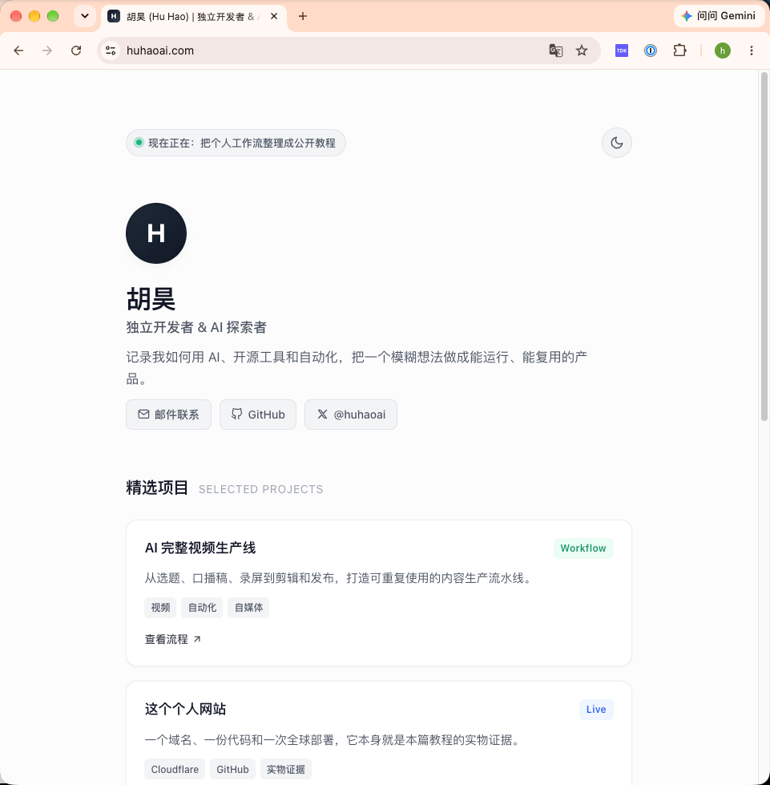

> **🎉 先看成品：这不是设计稿，是已经拥有独立顶级域名、全球部署上线的真实个人网站（`huhaoai.com`）！**

## 先说结果：你最后会得到什么

你会得到一个真正能打开的网页，而不是一堆“以后有空再做”的设计稿。

这个 Demo 有 4 个区域：

- **首页**：一句话说清楚你是谁、在做什么；
- **项目**：放 3 个已经做过或正在做的东西；
- **文章**：把零散的记录变成可以继续更新的入口；
- **关于我**：给别人一个联系你的方式。

完成标准只有 4 条：

1. 本地打开页面，手机宽度不乱；
2. 代码在 GitHub 仓库里；
3. Cloudflare Pages 生成一个 `pages.dev` 地址；
4. 你买的域名可以访问同一份页面。

收录、排名、做复杂后台，都不属于这次练习。先把第一条真实链接发给别人。

## 开工前先算一笔总账

第一次接触建站或购买域名时，难免会有一些疑问：“这得花多少钱？需要耗费多久？没有外币信用卡怎么办？”

在动手敲第一行字之前，我们先把这笔账算得清清楚楚：

- **需要花多少时间？** 跟着本教程一步步复制提示词，**大约只需要 1~2 小时**就能全流程跑通上线。
- **需要花多少钱？**
  - **代码与备份（GitHub）**：永久免费；
  - **服务器与全球访问（Cloudflare Pages）**：**永久免费，而且不限流量**；
  - **域名（Spaceship）**：**这是全流程唯一可能花钱的地方**。一个好用的域名首年大概只需十几块到三四十块人民币。而且**买之前完全不用掏钱**，我们会先用 Cloudflare 免费送的 `pages.dev` 把整个网站跑通、验证好，最后才去付款。
  - **需要信用卡吗？** **不需要！** 为什么我们推荐 Spaceship？除了它价格透明，最关键的一点是：**它原生支持支付宝付款！** 拿手机扫一下就能搞定。
- **本次目标**：这次跟练的核心是跑通人机协作的完整流程，而不是一开始就做复杂的业务大站。遇到任何终端提示，直接全选复制发给 AI，让它解释并处理即可。

## 你只需要准备 3 样东西

**第一，三个核心平台账号**：

- **GitHub**：存代码的云端网盘，电脑坏了代码也不会丢；
- **Cloudflare**：免费帮你把网站放到全球服务器上，还会送你一个开箱即用的免费网址（`pages.dev`）；
- **Spaceship**：买正式域名的地方，几十块钱/年，支持支付宝扫码付款。

**第二，一个 AI 编程工具**：

- 本文示范用的是 **Antigravity CLI (agy)**（Google 打造的终端 AI Agent，不卡顿、无额度塞车，轻快稳定）。
- 但**这套逻辑完全是通用的**：无论你用 **Claude Code**、**Codex**、**Cursor**、**Kimi**，还是 **Trae**、**WorkBuddy**，本质都一样——**你负责用自然语言表达想法与确认，AI 负责编写代码、执行命令和排查问题**。选择你手头最顺手的那个即可。

**第三，一个心仪的域名 + 3 段真实材料**：

- **域名**：做正式个人网站，域名是一定要买的（几十块钱/年）。先在心里想好一个名字（例如 `huhaoai.com`），我们在后半段会带你去 Spaceship 用支付宝买下并绑定。
- **3 段真实材料**：你是谁、做过什么、别人怎么联系你。不需要写得像严肃简历，把你在做的真实事实用大白话说出来即可。

## 全流程路线图：七个主线通关目标

这篇教程按一次真实交付的顺序编写，每一步都有明确的实物产出与四拍节奏（目标 → 指令 → 动作 → 验收）：

| 关卡 | 本关主线任务 | 你最后能拿到什么成果 |
| :--- | :--- | :--- |
| **关卡 0** | **地基就绪**：准备工具与全自动授权 | 终端环境就绪，agy / Git / Cloudflare 全部绿勾打通 |
| **关卡 1** | **理清需求**：架构师提示词与骨架确认 | 梳理出 4 块结构草稿，锁定需求不返工 |
| **关卡 2** | **代码生成**：原生极简页面与 Git 首次归档 | 本地生成 6 个核心网页文件，版本控制自动接管 |
| **关卡 3** | **本地预览与微调**：昼夜模式与真实作品替换 | 浏览器 `localhost` 检查自适应，换上真实项目与介绍 |
| **关卡 4** | **GitHub 备份**：远端仓库建立与代码上云 | 代码安全存入 GitHub 开源仓库，多端同步备份 |
| **关卡 5** | **Cloudflare Pages 部署**：拿到首个全球网址 | **拿到第一个全球可访问的免费公网网址（`pages.dev`）** |
| **关卡 6** | **Spaceship 域名直连**：绑定专属顶级域名 | 19.41 元买下 `.com` 并通过 Cloudflare 直连，正式独立站上线 |

> 💡 **核心逻辑**：域名故意放在部署之后。因为域名购买涉及真实付款，而 `pages.dev` 已经足够先验证产品。跑通免费上线后，再给它配上顶级域名，每一步都心中有底。

---

## 关卡 0：地基就绪 —— 工具检测与全自动账号授权

🎯 **通关目标**：在电脑中启动 agy，自动装齐 Git、Node.js 与 Wrangler，完成 GitHub 与 Cloudflare 授权，拿到一张全部绿勾 ✅ 的环境清单。

### 动作 1：启动终端并唤醒 agy

1. 打开系统自带的命令行窗口：
   - **macOS**：按 `Command ⌘ + 空格`，搜“终端”，回车；
   - **Windows**：点击“开始”，搜“PowerShell”，回车打开。
2. 安装 Antigravity CLI（按官方命令复制粘贴一次）：
   - **macOS / Linux**：`curl -fsSL https://antigravity.google/cli/install.sh | bash`
   - **Windows (PowerShell)**：`irm https://antigravity.google/cli/install.ps1 | iex`
   - *(Windows CMD 备用)*：`curl -fsSL https://antigravity.google/cli/install.cmd -o install.cmd && install.cmd && del install.cmd`
3. 验证与启动：
   - 输入 `agy` 回车启动，按浏览器页面完成 Google 账号首次登录授权。

> 💡 **首次启动 agy 全流程图解**：

| ① 终端执行安装并确认成功 | ② 输入 `agy` 启动并回车选择 OAuth |
| :---: | :---: |
| 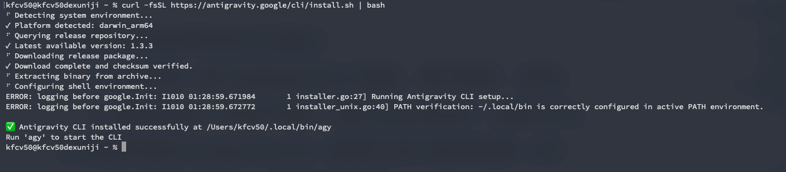 | 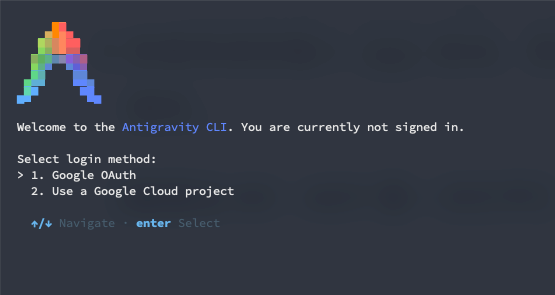 |
| **看到绿字 installed successfully** | **默认选中 Google OAuth，按 Enter** |

| ③ 终端生成授权链接 | ④ 浏览器登录并点击 Copy to Clipboard |
| :---: | :---: |
| 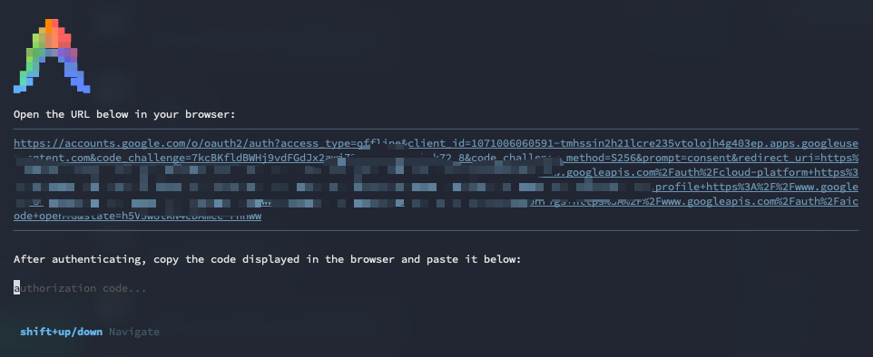 | 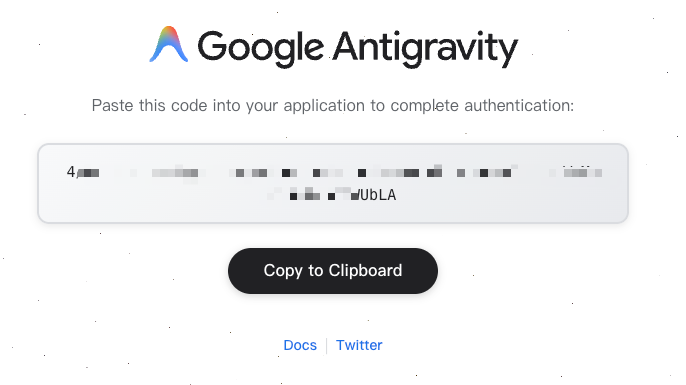 |
| **按住 Cmd 点击链接（或复制到浏览器）** | **登录 Google 账号并复制授权码** |

| ⑤ 授权码粘贴回终端 | ⑥ 选择配色方案 |
| :---: | :---: |
| 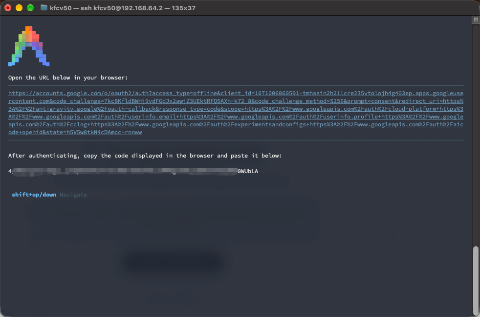 | 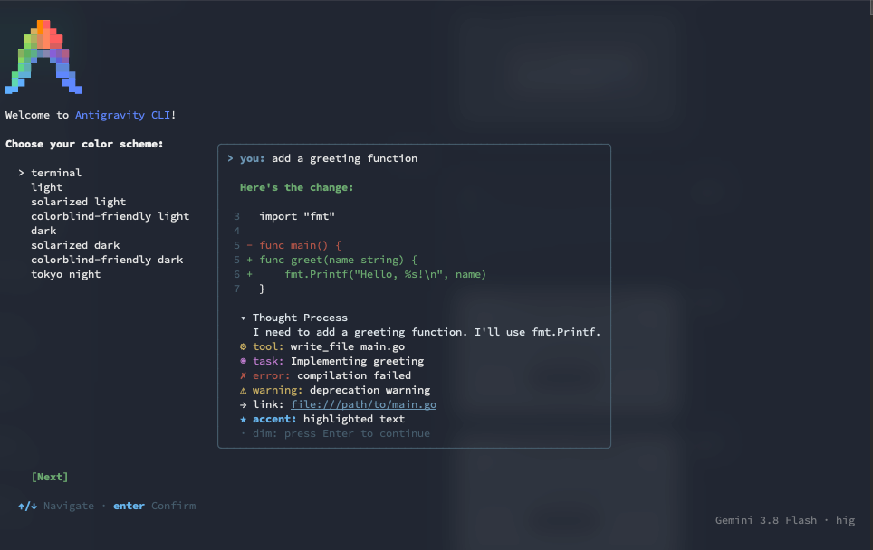 |
| **粘贴授权码并按回车** | **默认 terminal 配色，直接按回车** |

| ⑦ 确认服务协议 | ⑧ 信任项目工作区 |
| :---: | :---: |
| 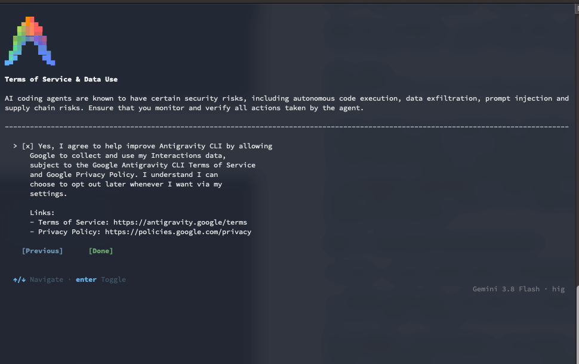 | 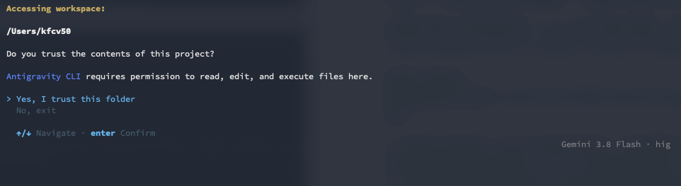 |
| **默认已勾选，直接回车 [Done]** | **默认选中 Yes, I trust this folder 回车** |

| ⑨ 正式进入交互主界面 |
| :---: |
| 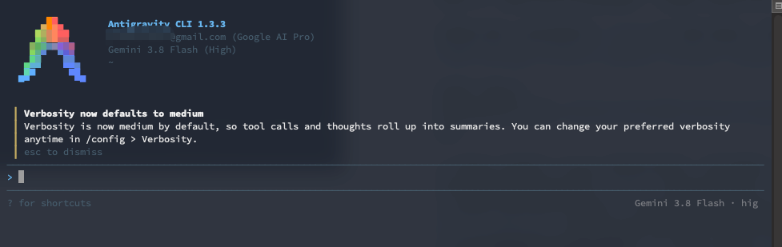 |
| **看到彩色 A 标志与交互光标，代表配置完毕** |

### 动作 2：让 AI 检查并安装基础环境

正式开工前，给网站建一个干净独立的空文件夹（建议使用你的名字或网名，本文以 `huhaoai` 示范），并在里面启动 agy：

```bash
mkdir huhaoai && cd huhaoai
agy
```

> **💡 效率技巧：免确认模式**：  
> 默认输入 `agy` 启动时，出于安全保护机制，每当执行命令都会请求确认（每次需按回车）：
>
> 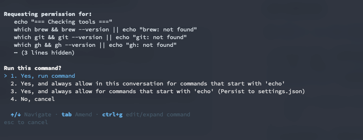
>
> 如果你不想频繁按回车确认，可以在启动时带上免确认参数：
>
> ```bash
> agy --dangerously-skip-permissions
> ```
>
> 这样它就会像全自动流水线一样一气呵成，省去反复按回车的麻烦。

启动就绪后，直接在终端底部的光标处把下面这段话发给它：

💬 **发给 AI 的指令**：
```text
我第一次做网站，电脑是全新的，请先全面检查 Git、GitHub CLI（gh）、Node.js 和 Cloudflare Wrangler。
如果连 Homebrew 等基础包管理器都没有，请用最省事的方式帮我自动安装或引导配置；
遇到需要我点击系统弹窗、输入开机密码或授权时，用大白话告诉我该怎么配合就行。
```

> **💡 系统说明**：由于作者平时主要在 **macOS** 环境下实操开发，以下截图与底层环境排雷细节以 **Mac 电脑** 为主。  
> **Windows 用户提示**：Windows 没有苹果弹窗和 Homebrew，AI（以 agy 为例）会自动调用系统的 `winget` 或官方安装包完成 Git、Node.js 与 Wrangler 配置，遇到系统的“用户账户控制（UAC）”弹窗点击「是」即可，无需手动安装第三方包管理器。

如果你使用的是一台全新 Mac，AI 会先全面扫描并打印出一张环境清单。初次使用全部显示红叉 ❌ 属于正常的初始状态：

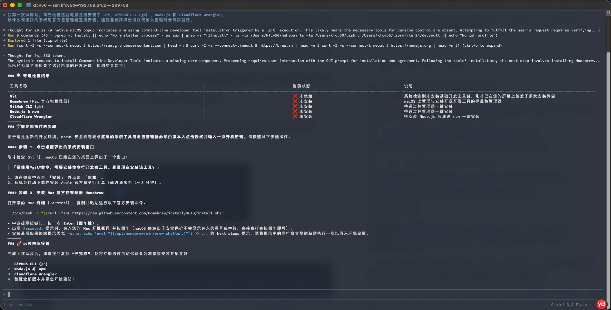

由于 macOS 底层的安全保护机制，有 **两处系统授权需要由你本人点击确认**，AI 无法越权代劳：

#### 1. 允许系统安装开发者工具
检查 Git 时，桌面会弹出一个系统窗口提示：*「要使用“git”命令，需要安装命令行开发者工具。是否现在安装该工具？」*

| 步骤 1：点击弹窗中的「安装」 | 步骤 2：协议窗口点击「同意」 |
| :---: | :---: |
| 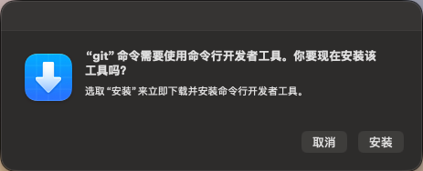 | 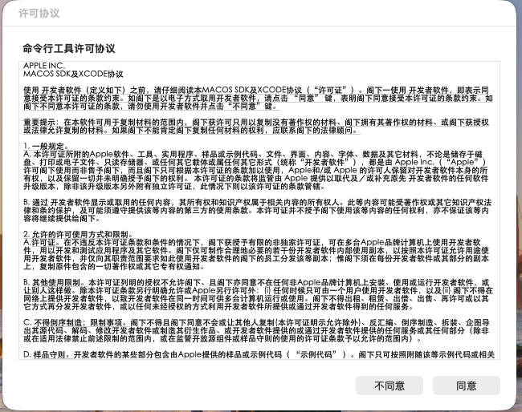 |
| **点击「安装」** | **点击右下角「同意」** |

> **💡 遇到“华文黑体”弹窗说明**：  
> 点击「安装」后，部分 Mac 可能会紧接着弹出一个提示：*「Install Command Line Developer Tools 需要下载字体“华文黑体”（9.1 MB）」*。这是因为苹果安装协议在渲染中文时需要该字体，**直接点「下载」或「跳过」均可**，完全不影响正常安装：
>
> 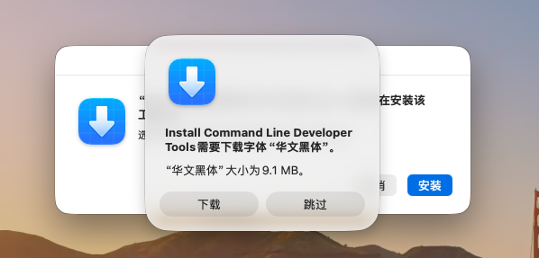

点击同意后，系统会先后进入下载与安装进度条，完成后点击「完成」：

| 下载进度条（约 2~3 分钟） | 安装进度条（自动切换） | 安装完成点击「完成」 |
| :---: | :---: | :---: |
| 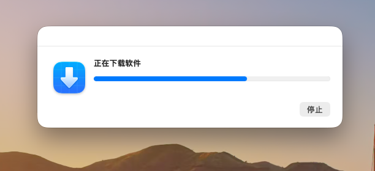 | 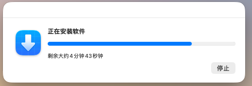 | 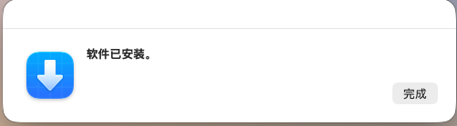 |

#### 2. 安装 Mac 官方包管理器 Homebrew
AI 会贴心地把官方安装命令准备好：

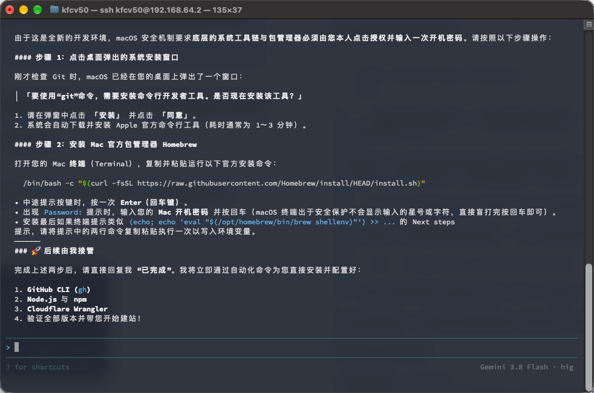

按快捷键 **`Command ⌘ + T`** 在终端新建一个标签页，把下面这行官方命令粘贴进去回车：

```bash
/bin/bash -c "$(curl -fsSL https://raw.githubusercontent.com/Homebrew/install/HEAD/install.sh)"
```

- **输入开机密码**：出现 `Password:` 提示时，输入你的 **Mac 开机密码** 并按回车（注意：macOS 终端输入密码时不显示星号，直接输完回车即可）；
- **确认继续**：看到 `Press RETURN/ENTER to continue` 提示时，直接按一次 **回车键（Enter）**；
- **完成提示**：终端看到 `Installation successful!`，代表 Homebrew 安装成功：

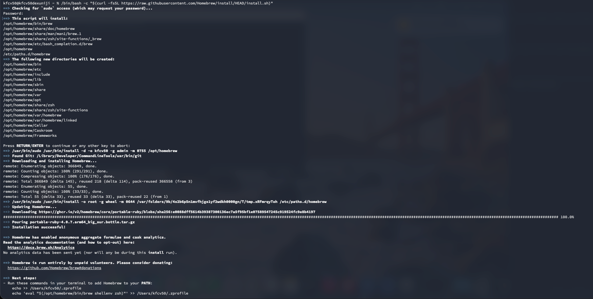

> **💡 写入环境变量**：  
> 按照终端底部的 `Next steps:` 提示，把这两行命令在终端执行一次，让系统全局识别 `brew` 命令：
>
> ```bash
> (echo; echo 'eval "$(/opt/homebrew/bin/brew shellenv)"') >> ~/.zprofile
> eval "$(/opt/homebrew/bin/brew shellenv)"
> ```
> *(注：国内网络如果遇到超时，可换用国内镜像源：`/bin/zsh -c "$(curl -fsSL https://gitee.com/cunkai/HomebrewCN/raw/master/Homebrew.sh)"`)*

#### 3. 后续全部由 AI 接管！
完成上述两步后，关掉临时的终端标签页，切回 agy 窗口回复：`已完成`。

AI 收到后，会自动在后台静默安装 **GitHub CLI (gh)**、**Node.js & npm**、**Cloudflare Wrangler**，并自动帮你把环境变量写入 `~/.zprofile`。

安装完成后，终端会直接输出一张**全部为绿色对勾 ✅ 的版本清单**：

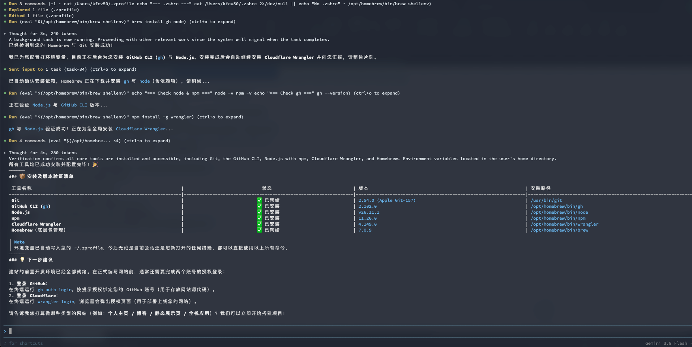

至此，所有核心开发工具与底层环境变量已经配置完毕，建站所需的前置开发环境已经准备就绪。

### 动作 3：完成 GitHub 与 Cloudflare 双授权

开发环境就绪后，把下面这段话发给 AI：

💬 **发给 AI 的指令**：
```text
请按顺序帮我完成 GitHub CLI 和 Cloudflare Wrangler 的登录授权。
每次需要我在浏览器点击确认时，请停下来告诉我。
```

#### ① GitHub CLI 授权登录
AI 会自动调用命令调起默认浏览器打开 GitHub 设备绑定页面，并在终端输出一个 8 位一次性授权码：

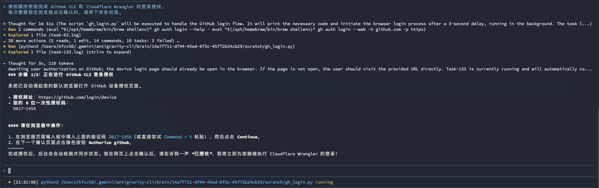

🛠️ **你的微小动作**：
浏览器会自动填入这 8 位验证码，点击 **Continue**，并在跳转页点击绿色的 **Authorize github**：

| 输入/核对 8 位验证码 | 点击 Authorize github 确认授权 |
| :---: | :---: |
| 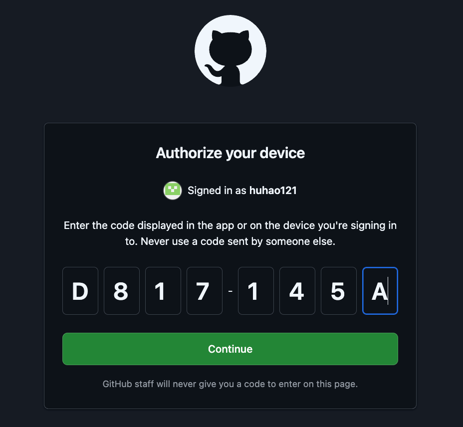 | 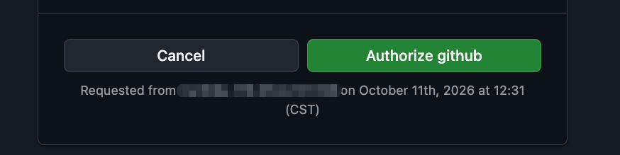 |
| **点击 Continue** | **点击 Authorize github** |

✅ **验收结果**：网页显示带绿色对勾的成功提示 *“Congratulations, you're all set! Your device is now connected.”*：

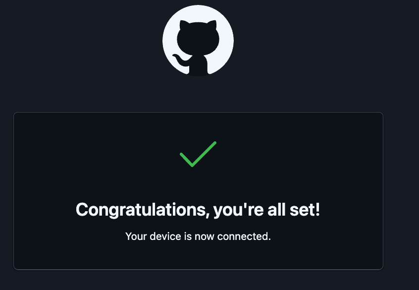

回到终端对 AI 回复一句：`已授权`。

#### ② Cloudflare Wrangler 授权登录

> **什么是 Cloudflare？**  
> Cloudflare 是全球知名的云基础设施与 CDN 服务商。它的产品 **Cloudflare Pages** 为开发者提供**永久免费、不限带宽流量**的全球静态网页托管，并免费赠送 `.pages.dev` 域名和顶级 HTTPS 安全证书。我们本地的网页代码，就是通过它的官方命令行工具 `wrangler` 部署到全球边缘节点上。

🛠️ **你的微小动作：直接用 GitHub 或 Google 一键免密登录！**

1. **选择登录方式**：浏览器自动弹出 Cloudflare 登录页面（`dash.cloudflare.com/login`）时，推荐首选点击 **GitHub** 图标一键免密登录（或点击 Google 登录）：

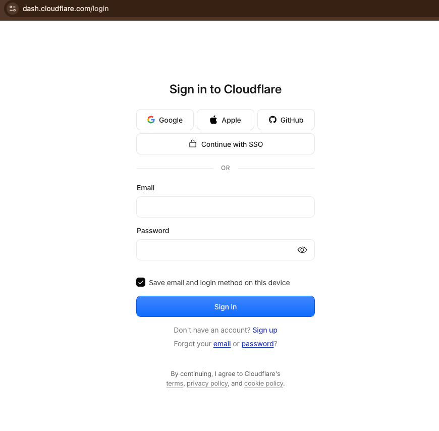

> **⚠️ 关键排雷：出现红字 “Your account uses a different login provider” 怎么办？**  
> 如果弹出红字报错，说明你的邮箱以前曾用 Google 注册过。直接点击上方的 **Google** 图标登录即可：
>
> 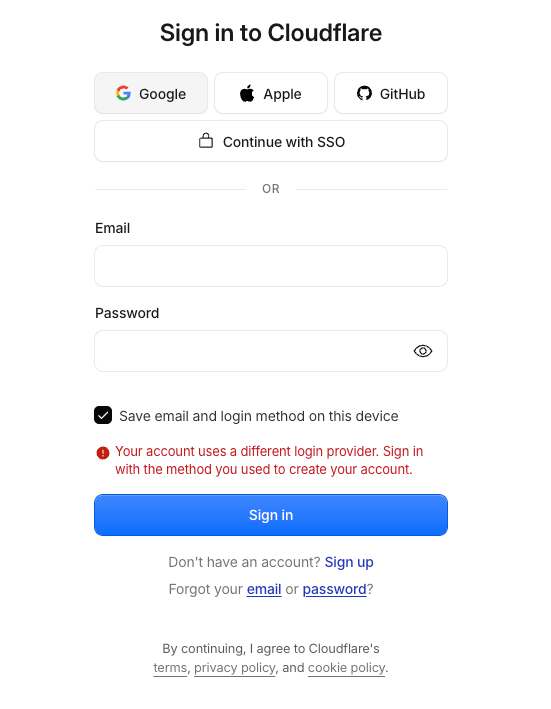

| 分支 A：选择 GitHub 登录 | 分支 B：选择 Google 登录 |
| :---: | :---: |
| 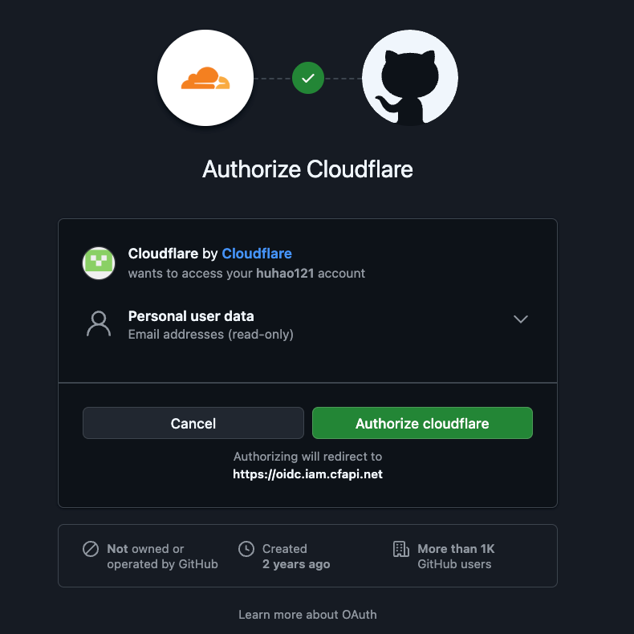 | 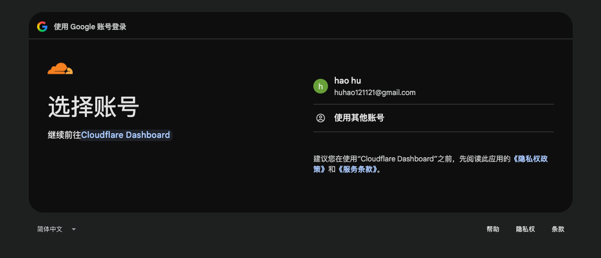 |
| **点击 Authorize cloudflare** | **点击你的 Gmail 账号一键登录** |

2. **终端生成专属设备链接**：终端会自动生成专属授权直达链接：

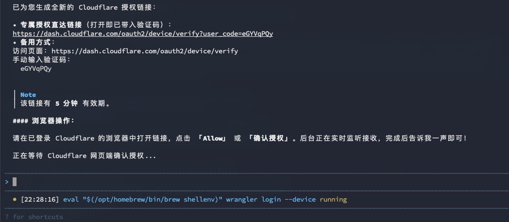

3. **浏览器核对验证码并确认授权**：按住 `Command ⌘` 点击该链接，或复制到浏览器打开：

| 自动填入 8 位验证码 | 点击 Authorize 允许权限 |
| :---: | :---: |
| 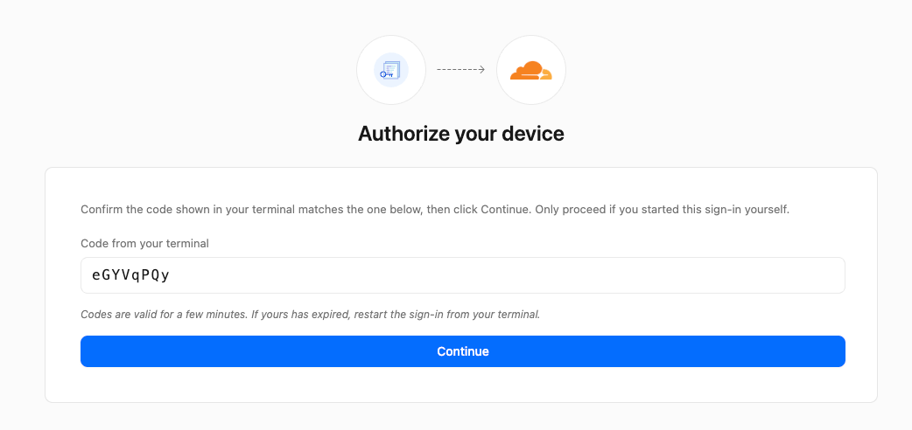 | 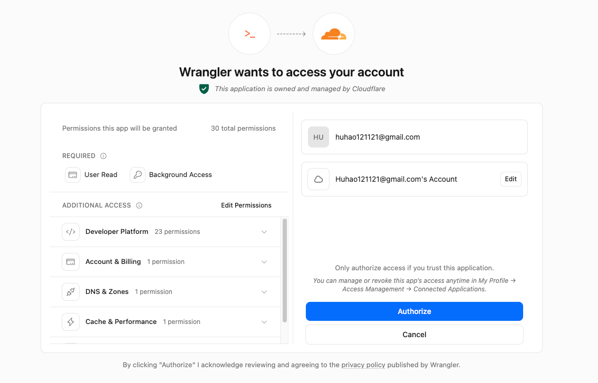 |
| **点击蓝色的 Continue** | **点击蓝色的 Authorize** |

✅ **验收结果**：
网页弹出带绿色对勾的成功提示卡片 *“Authorization granted to Wrangler”*：

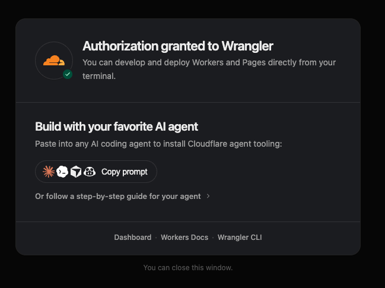

关闭该网页，切回终端对 AI 回复：`已授权`。

AI 收到后自动核验，在终端输出所有工具与授权全部绿勾的最终面板：

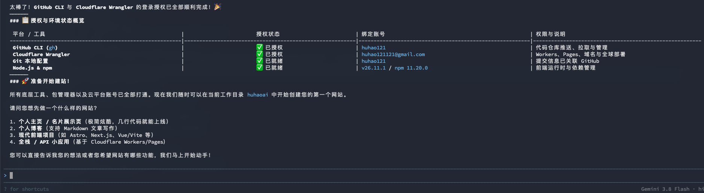

至此，基础开发工具和平台授权均已配置完毕。接下来，我们就可以直接通过自然语言让 AI 开始编写网站代码。

---

## 关卡 1：理清需求 —— 架构师提示词与骨架确认

🎯 **通关目标**：在写代码之前，让 AI 以架构师视角梳理出 4 块核心结构与文件清单，确认需求，杜绝返工。

此时 AI 在终端询问你：*“请问您想先做一个什么样的网站？1. 个人主页 / 名片展示页... 2. 个人博客...”*。
初次使用 AI 编程时，如果一开始的描述过于泛化，AI 容易自由发挥而偏离我们心目中的预期。在正式写代码之前，先让 AI 把结构规划清楚。

💬 **发给 AI 的指令**：
```text
我想做一个极简个人网站，目标是让别人快速知道我是谁、做过什么、如何联系我。
请先用大白话问我 5 个以内的问题确认需求，在我回答完之前不要写代码；确认后再输出页面结构与文件清单。
```

发送之后，AI 就会像一位经验丰富的全栈产品经理一样，用大白话梳理出 4 个核心维度来向你确认：

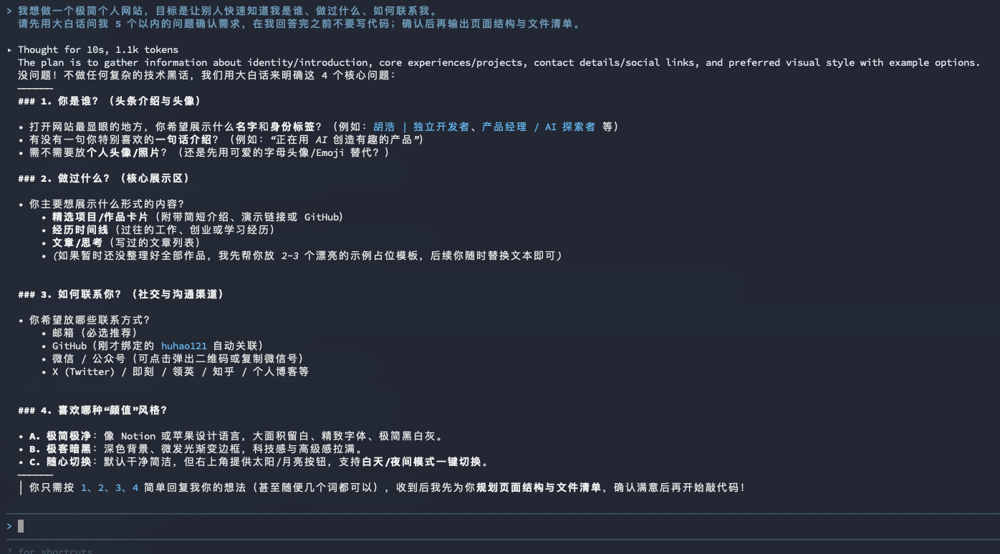

🛠️ **你的微小动作（直接复制参考模板）**：
面对 AI 的提问，直接复制下面这套参考模板发送给 AI（把里面的名字与介绍换成你自己的）：

```text
1. 名字与介绍：
   名字：胡昊 | 独立开发者 & AI 探索者
   一句话介绍：正在用 AI 创造实用、有趣、利他的工具与内容
   头像：先用设计感大气的字母头像/圆形占位符，方便我后续随时替换成个人照片。

2. 做过什么（核心展示区）：
   请帮我设计 3 个精选项目/作品卡片，先放 3 个带标签和简短描述的示例占位，后续我随时替换文本。

3. 联系方式：
   包含：邮箱（huhao121121@gmail.com）、GitHub（直接关联 huhao121）、X(@huhaoai)。

4. 颜值风格：
   选 C：极简黑白灰风格，右上角支持浅色与深色模式切换。

请按以上设想，先输出页面的结构规划与文件清单，等我确认后再动手写代码！
```

> **🎯 为什么推荐这套方案？**
> - **字母头像占位**：前期可以先不用把时间花在挑选个人照片上，先用设计感字母头像跑通完整流程，后续随时可以替换；
> - **3 个精选卡片**：个人主页展示 3 个核心项目，排版整洁、重点突出；
> - **昼夜模式（风格 C）**：右上角支持浅色与深色模式切换，视觉舒适，交互更完整。

✅ **结果验收**：
AI 在终端输出规划好的页面结构与文件清单：

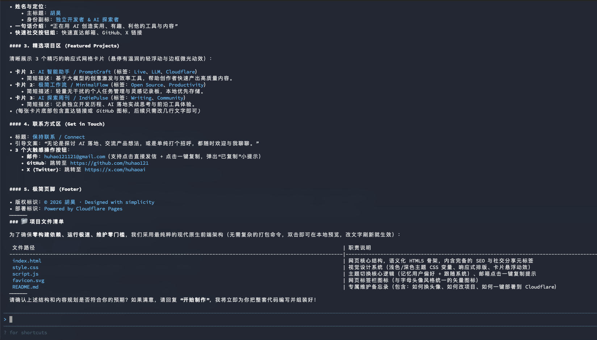

AI 会贴心地为你规划好：
- **3 个精选响应式项目卡片**（PromptCraft、MinimalFlow、IndiePulse），自带标签与优雅悬停微动效；
- **全纯外链社交沟通渠道**（邮箱一键复制、GitHub 跳转、X 链接跳转）；
- **零构建原生前端架构**：包含 `index.html`（语义化 HTML5 骨架）、`style.css`（浅色/深色主题 CSS 变量）、`script.js`（昼夜一键切换与邮箱复制）、`favicon.svg`（矢量图标）与专属维护备忘录 `README.md`。

---

## 关卡 2：代码生成 —— 原生极简页面与 Git 首次归档

🎯 **通关目标**：让 AI 生成 6 个原生核心网页文件，并自动完成 Git 仓库初始化与首次 Commit 存档。

既然结构规划已经完全符合预期，现在就可以正式让 AI 动手编写代码了！
但在写代码的同时，我们一定要让 Git 版本控制顺便跑起来（让 Git 接住每一次改动，以后随时可以一键回退、安心折腾）。

💬 **发给 AI 的指令**：
```text
方案很棒，直接开始做吧！
顺便帮我把当前目录初始化为 Git 仓库（main 分支 + .gitignore），全部写好后帮我提交第一版代码。
```

> **💡 为什么顺带加上 Git 要求？**  
> 这样 AI 在写好代码后，会自动执行 `git init` 并完成首次提交（Commit），省去手动输入版本管理命令的步骤。

🛠️ **你的微小动作**：
发送指令后静待 10~20 秒，无需进行任何额外操作。

✅ **结果验收**：
AI 在后台生成全套代码并完成 Git 首次归档。终端会输出生成的文件清单与 Commit 记录：

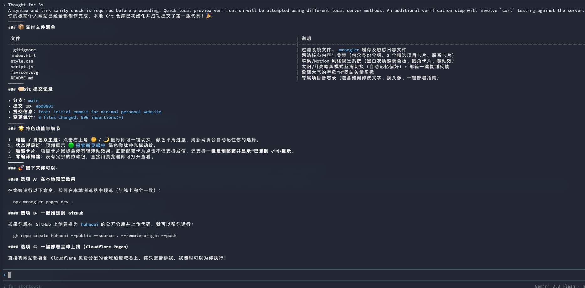

> **🎉 第一阶段交付成果**：
> - **6 个核心文件全部生成**：包含结构、样式、昼夜逻辑、图标、Git 忽略规则与使用备忘；
> - **Git 首次提交完成**：自动生成 Commit ID（如 `ebd0801`），代码有了第一版版本记录；
> - **交互细节完整**：支持右上角浅色/深色主题切换、顶部状态胶囊、卡片悬浮微动效与点击邮箱自动复制。

---

## 关卡 3：本地预览与微调 —— 昼夜模式检查与真实内容替换

🎯 **通关目标**：在本地浏览器预览网站，完成手机宽度自适应与昼夜模式检查，并将占位模板替换为自己的真实项目与介绍，完成第二次 Git 存档。

### 动作 A：本地启动预览与视觉交互检查

此时 AI 在终端给出了本地预览选项。既然我们在做人机协同开发，这类运行和打开预览的动作，完全可以让 AI 代劳：

💬 **发给 AI 的指令**：
```text
请帮我直接在本地启动预览，并自动在浏览器中打开网页让我看看效果。
```

> **💡 协作优势**：
> AI 收到指令后，会在后台自动启动本地服务，并且**自动唤起默认浏览器打开网页**，直接就能在屏幕上看到自己的网站效果。

🛠️ **你的微小动作**：
浏览器自动弹出本地预览网页（`localhost:8788`），进行 3 项快速检查：
1. 点击右上角 🌞 / 🌙 图标，测试白天与夜间模式切换是否顺滑；
2. 把浏览器窗口拖动缩窄到手机屏幕宽度，确认排版自适应、文字不换行截断；
3. 点击底部的邮箱按钮，测试是否会弹出“已复制 ✔️”的小提示。

✅ **验收效果（桌面与移动端昼夜模式对照）**：

| 浅色模式（白天） | 深色模式（夜间） |
| :---: | :---: |
| 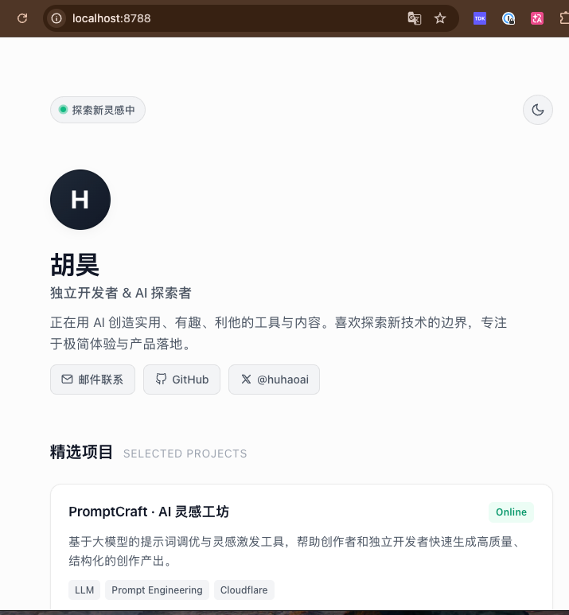 | 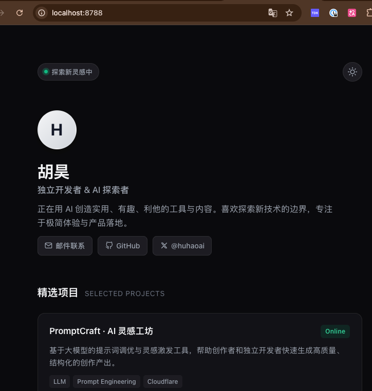 |
| **顶部状态胶囊 + 居中字母头像** | **深色背景自适应 + 偏好本地持久化** |

> **🌟 界面设计细节**：
> - **顶部状态胶囊**：动态呼吸绿灯显示 `🟢` 状态，清晰展示当前的专注方向；
> - **字母头像**：无需复杂配图，采用居中的字母图标，简洁大方且易于后续替换；
> - **昼夜主题切换**：点击右上角的月亮 🌙 / 太阳 ☀️ 按钮，整套页面的背景与字体颜色平滑过渡，并自动将偏好保存在本地浏览器缓存中。

---

### 动作 B：把占位文字替换为真实项目与介绍

看完第一版预览后，大家最关心的通常是：**“页面效果很不错，但我怎么把里面的示例文字换成我自己的真实经历和作品？”**  
我们不需要自己翻开 HTML 代码去逐行手动查找修改，直接用自然语言告诉 AI 替换的内容，改完让它顺便提交 Git 存档即可：

💬 **发给 AI 的指令（替换为你的真实素材）**：
```text
效果很棒！现在请帮我把网页里的占位文本，替换成我的真实项目和内容：
1. 一句话介绍改成：“记录我如何用 AI、开源工具和自动化，把一个模糊想法做成能运行、能复用的产品。”
2. 顶部状态改成：“🟢 现在正在：把个人工作流整理成公开教程”
3. 3个精选项目卡片改成：
   - 卡片1：AI 完整视频生产线（标签：视频、自动化、自媒体）
     描述：从选题、口播稿、录屏到剪辑和发布，打造可重复使用的内容生产流水线。
   - 卡片2：这个个人网站（标签：Cloudflare、GitHub、实物证据）
     描述：一个域名、一份代码和一次全球部署，它本身就是本篇教程的实物证据。
   - 卡片3：开源工具与工作流实验（标签：开源、脚本、提示词）
     描述：开源 autocut-skill 视频去停顿剪辑工具与日常实用 AI 脚本，开箱即用。

修改完成后自动保存并提交 Git，然后刷新本地预览让我看看！
```

✅ **结果验收**：
AI 在后台全自动修改代码，执行新一轮 Git 提交，并在终端为你打印出清晰工整的 **更新前后内容对比清单**：

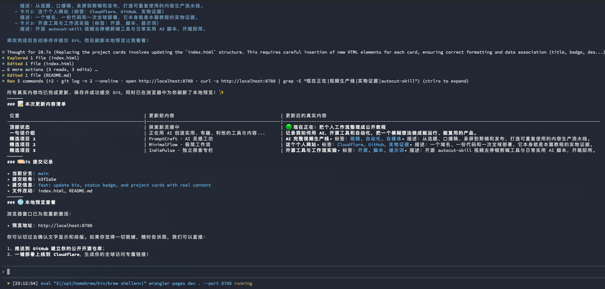

> **🎉 第二阶段交付成果**：
> - **更新前后对比一目了然**：从状态胶囊、一句话介绍到 3 个精选项目，所有改动清清楚楚呈现；
> - **自动完成第二次 Git 存档**：生成新的提交记录（Commit ID: `b3f2a5e`，提交信息 *feat: update bio, status badge, and project cards with real content*），改动全程版本留痕；
> - **自动唤起浏览器刷新**：终端改完后会自动激活浏览器，呈现刷新后的网页效果。

本地浏览器端自动刷新后的全新真实主页效果：

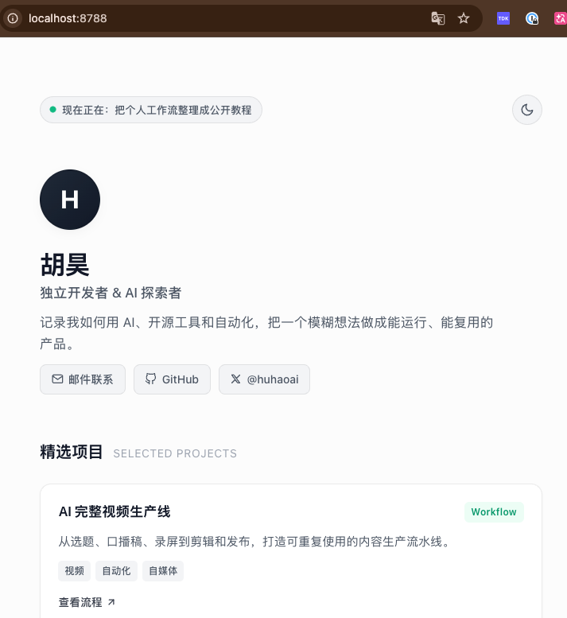

此时，个人网站上的内容已经替换为真实的个人信息与项目：
- 顶部状态显示正在进行的真实动态；
- 卡片展示具体的作品、开源工具与经历；
- 内容结构清晰真实，随时可以对外展示。

---

## 关卡 4：GitHub 备份 —— 远端代码仓库建立与云端安全备份

🎯 **通关目标**：通过 GitHub CLI 自动创建公开远端仓库，将本地代码推送至 main 分支，完成云端安全同步备份。

让 AI 把本地代码直接推到 GitHub（公开或私有由你定）：

💬 **发给 AI 的指令**：
```text
请用 GitHub CLI，把当前目录直接创建为名为 huhaoai 的公共仓库并推送到 main 分支。
如果需要我点击网页授权，请停下来叫我；完成后把仓库地址发给我。
```

> **💡 零额外操作**：因为在关卡 0 中已经授权过 `gh auth login`，AI 会在后台全自动完成建仓、凭证关联与主分支推送，无需在网页端手动重复操作。

🛠️ **你的微小动作**：
发送指令后静待几秒，点击 AI 输出的仓库链接查看。

✅ **结果验收**：
终端直接返回创建成功的公开仓库信息，并在网页端看到正规完整的开源项目主页：

| 终端自动建仓与推送详情 | GitHub 线上仓库主页 |
| :---: | :---: |
| 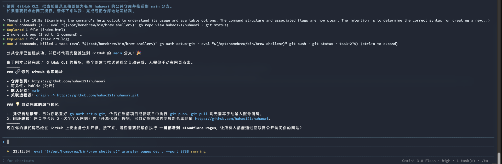 | 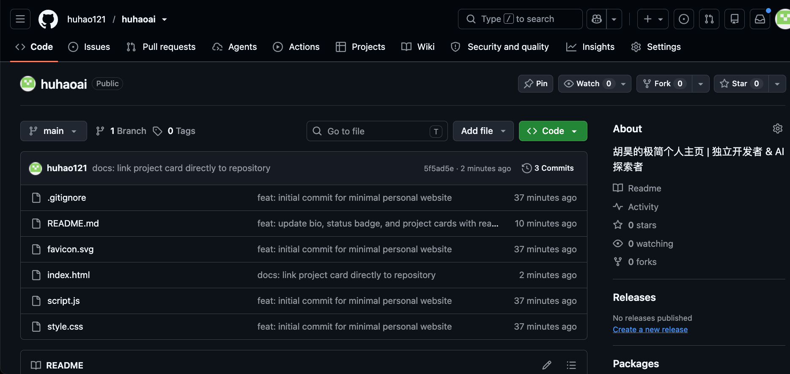 |
| **凭证自动配置，推送成功** | **代码安全归档，提交记录完整** |

> **💡 自动完成的细节配置**：
> 1. **凭证自动配置**：自动配置好 `gh auth setup-git`，后续执行 `git push` 或 `git pull` 均免密进行；
> 2. **开源地址自动关联**：AI 还细心地将网页中卡片 2（这个个人网站）的“开源代码”跳转按钮，自动更新为刚刚生成的新仓库地址 `https://github.com/huhao121/huhaoai`。

打开你的 GitHub 仓库（`https://github.com/huhao121/huhaoai`），可以看到仓库设置为 Public（公开），包含清晰的提交历史，所有网页源码与配置文件均已安全备份在云端。

---

## 关卡 5：Cloudflare Pages 部署 —— 拿到首个免费全球公网网址

🎯 **通关目标**：使用 Wrangler 将网站一键部署至 Cloudflare Pages 生产环境，拿到首个全球可访问的公网网址（`pages.dev`）并完成健康检查。

这是整个建站流程中最激动人心的时刻之一：你的网站将第一次接入全球互联网，任何人只要在浏览器输入网址就能访问。

💬 **发给 AI 的指令**：
```text
请用 Cloudflare Wrangler 创建名为 huhaoai 的 Pages 项目（注意：如果报错请带上 --force 参数），并把当前目录部署到生产环境。
部署完成后告诉我线上网址，并帮我验证是否能返回 200。
```

> **💡 避坑要点**：Wrangler 首次创建 Pages 项目如果报 `Missing entry-point`，带上 `--force` 即可解决（已写在提示词中）。

🛠️ **你的微小动作**：
静待 AI 完成上传部署与连通性验证。

✅ **结果验收**：
AI 在终端自动执行 HTTP 状态验证并返回 `HTTP/2 200 OK ✅`，同时自动调起浏览器打开正式上线的全球网址：

| 终端部署成功并返回 200 OK | 浏览器打开正式公网网址 |
| :---: | :---: |
| 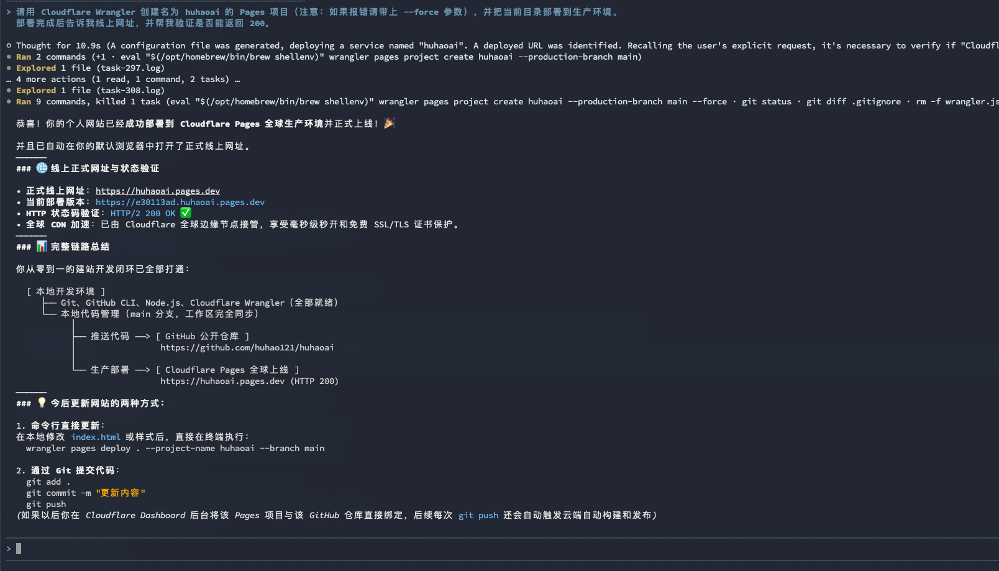 | 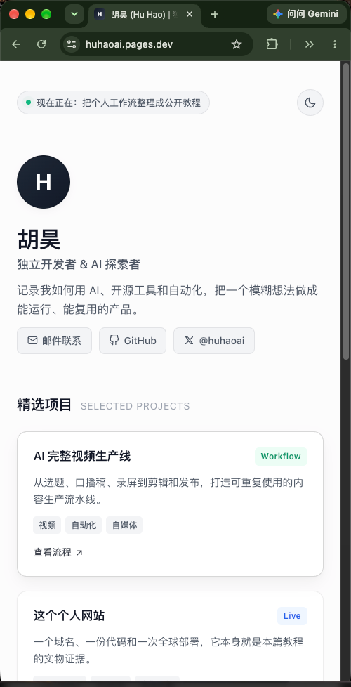 |
| **分配免费域名 `huhaoai.pages.dev`** | **全球 CDN 加速，自带 HTTPS 绿锁** |

> **💡 部署完成验证（HTTP/2 200 OK）**：
> - **正式公网网址**：`https://huhaoai.pages.dev`（公网可直接访问）；
> - **自动健康检查**：AI 自动调用命令验证返回 `HTTP/2 200 OK ✅`，确保页面真实可用；
> - **全球 CDN 加速**：网站已接入 Cloudflare 边缘网络，并自动配置免费 SSL/TLS 证书保护；
> - **后续更新指南**：修改代码后只需在终端执行 `wrangler pages deploy . --project-name huhaoai --branch main`，或直接执行 `git push`，即可完成更新部署。

此时浏览器地址栏中显示的是正式的公网网址 **`huhaoai.pages.dev`**，并带有 HTTPS 安全锁。至此，你的个人主页已经正式部署上线，可以在任何设备上通过公网访问。

---

## 关卡 6：Spaceship 域名直连 —— 19.41 元绑定独立顶级域名

🎯 **通关目标**：在 Spaceship 使用支付宝以新用户优惠价（CN¥19.41）购入专属 `.com` 域名，通过 Cloudflare Nameservers 直连绑定到 Pages，实现 `https://huhaoai.com` 全球畅通访问。

网站已经在免费的 `pages.dev` 跑通了，如果你想让网站更加专业（例如使用专属的 `huhaoai.com`），我们就可以为它绑定一个正式的国际顶级域名。

> **💡 为什么推荐 Spaceship？**
> 1. **免实名认证**：无需上传身份证件或等待审核，注册即可购买；
> 2. **支持支付宝付款**：支持使用支付宝直接以人民币结算，无需准备外币信用卡；
> 3. **价格透明**：首年与续费价格清晰（.com 域名通常在 60~70 元人民币/年左右），没有隐藏附加费用；
> 4. **免费 WHOIS 隐私保护**：默认隐藏域名的联系方式与邮箱，防止公开信息被推销骚扰。

---

### 动作 A：注册 Spaceship 并选购域名

#### 1. 注册 Spaceship 账号
打开 [Spaceship 官网](https://www.spaceship.com/)，点击页面右上角的登录按钮。在弹出的登录窗口中，因为我们是新用户，**直接点击底部的蓝色文字 `Sign up`**：

| 步骤 1：点击底部的 Sign up | 步骤 2：填写基础资料并进入密码设置 |
| :---: | :---: |
| 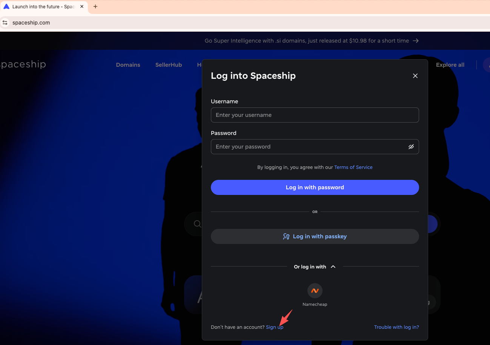 | 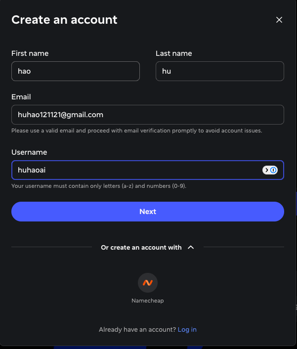 |
| **点击 Sign up 注册新账号** | **填写姓名、邮箱、用户名** |

按提示依次输入你的基础信息：
- **First name / Last name**（名 / 姓）：直接输入英文或拼音即可（例如 `hao` / `hu`）；
- **Email**（常用邮箱）：输入真实有效的个人邮箱（如 Gmail 或 163 等），后续 Spaceship 会向该邮箱发送国际域名 ICANN 激活邮件；
- **Username**（用户名）：仅支持英文字母与数字（例如 `huhaoai`，若已被注册可在末尾加数字）；
- 填写完成后，直接点击蓝色的 **Next** 按钮进入密码设置页面：

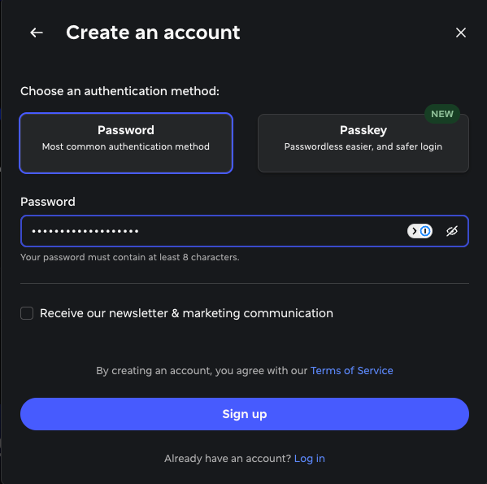

在密码设置页面依次操作：
- **认证方式**：保持默认选中的 **Password** 即可；
- **Password**（密码）：输入至少 8 位的安全密码（建议包含大小写字母和数字）；
- **建议取消勾选营销邮件选项**：取消勾选 `Receive our newsletter & marketing communication`，避免收到广告营销邮件；
- **人机验证**：点击 **Verify you are human** 前方的小方框；
- 确认无误后，点击蓝色的 **Sign up** 按钮；
- 页面会弹出最后一关安全验证（*Email security verification*）。此时打开你的注册邮箱（如 Gmail），会收到一封来自 Spaceship 官方的验证信，里面标有一串显眼的 6 位蓝色验证码：

| 注册邮箱收到 6 位验证码 | 填入弹窗并点击 Verify |
| :---: | :---: |
| 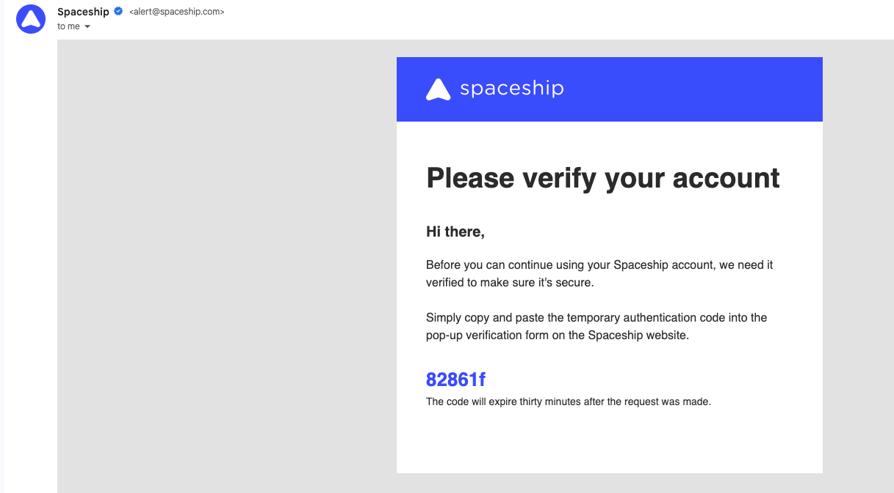 | 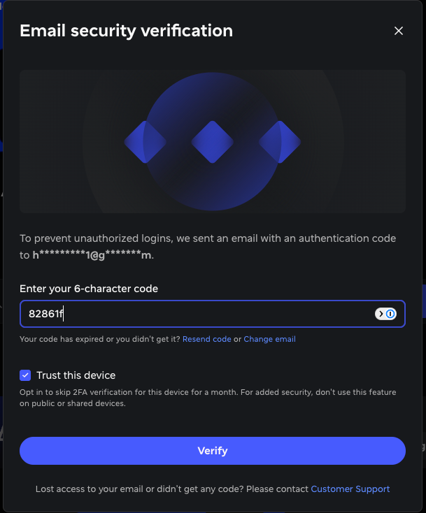 |
| **邮件标题包含 6 位验证码** | **填入并保持勾选 Trust this device** |

最后点击蓝色的 **Verify** 按钮，整个账号注册即彻底大功告成，直接进入控制台主页！

#### 2. 查域名与结账
注册登录完成后，回到 Spaceship 首页。在正中央的大搜索框输入你想买的域名名字（例如 `huhaoai`），点击蓝色的 **Search** 按钮：

| 首页搜索框输入域名 | 搜索结果点击 Add to cart |
| :---: | :---: |
|  |  |
| **输入域名并点击 Search** | **认准正统 .com 域名加入购物车** |

> **💡 域名挑选指南**：
> - **优先认准 `.com`**：国际最通用、大众认知度最高的正统顶级域名首选永远是 `.com`（例如 `huhaoai.com`）；
> - **操作动作**：直接在 `huhaoai.com` 这一行的右侧，点击蓝色的 **Add to cart** 按钮将其加入购物车。

🎁 **新用户专属促销代码（立减至 19.41 元）**

将域名加入购物车后，**记得先使用专属优惠码**。Spaceship 为新用户首年购买 `.com` 域名提供了大幅折扣，可以省下一大笔费用：

1. **展开右侧购物车**：点击加入购物车后，页面右侧会自动滑出 **1 item** 结算抽屉（若未滑出，点击页面右上角购物车图标即可）。
2. **找到促销代码输入框**：在抽屉下方，找到 **Promo code**（促销代码）一栏。
3. **输入新用户优惠码**：
   - 首选优惠码：**`COMPROS`**（实测立减）
   - 备用优惠码：**`COM67`**（首选代码失效时备用）
4. **点击应用生效**：输入优惠码后点击右侧应用，页面价格会立即更新：
   - `.com` 域名首年注册费从原价 **CN¥64.65** 优惠至 **CN¥18.07**；
   - 加上国际域名监管 ICANN 官方工本费（CN¥1.34），**首年总价最终仅需 CN¥19.41**；
   - 折合不到 20 元人民币即可拥有一整年的 `.com` 域名使用权。


5. **点击结算按钮**：确认右下角折扣已成功应用、总价显示为 **CN¥19.41** 后，点击蓝色的 **Checkout** 按钮。

#### 3. 补充域名联系人（Domain Contacts）

如果是新账号第一次买域名，点击 Checkout 时页面可能会弹出提示：`Additional information is required for this item`，并在域名下方标红显示 `Domain Contacts: Info required`（需要补充域名联系人信息）：

| 提示需补充域名联系人 | 点击 + Add Address 登记地址 |
| :---: | :---: |
|  |  |
| **点击红色的 Edit 或 Take me there** | **勾选共用此地址，点击 + Add Address** |

> **💡 为什么会有这个提示？会泄露个人信息吗？**
> - **ICANN 国际惯例**：国际互联网域名管理机构（ICANN）规定，全球任何注册顶级域名（.com / .org 等）的机构都必须登记一套所有者基本联系信息。
> - **终身免费隐私保护**：注意看上方清晰标明的 **`Privacy: Included for free, forever`**！Spaceship 终身免费自带 WHOIS 隐私盾牌，你在此处登记的姓名与地址在公网上会被完全隐藏，绝不会被推销电话骚扰。

**填写操作步骤**：
1. 点击那一行红色的 **`Edit`** 按钮（或顶部的蓝色 **`Take me there`** 按钮）；
2. 页面会弹出域名联系人配置弹窗，直接点击中间的 **`+ Add Address`** 按钮；
3. 下方默认勾选的 **`Use the same address for administrative, technical, and billing contacts.`**（管理、技术与账单联系人共用此地址）**请务必保持勾选**！这样只需填一次，系统就会自动套用到 ICANN 规定的所有 4 个联系人角色，免去重复填 4 遍的麻烦；
4. 在展开的地址表单中填写基本信息（**注意：国际域名系统只支持英文或拼音，请勿直接输入中文汉字**）。这里有两种极其省心的填写方式：
   - **方式一：使用「美国地址生成器」快速生成**：
     如果不想填写日常真实住址，由于 Spaceship 不会寄送纸质账单且自带免费隐私保护，你可以直接使用在线的 [美国地址生成器](https://meiguodizhi.com/)（如 Oregon 免税州地址）：

     

     - **Full Name**：填自己拼音（例如 `hao` / `hu`）或生成的英文名；
     - **Address**：直接复制生成的街道（例如 `3413 Seneca Drive`）；
     - **Country**：下拉选择 `United States`；
     - **State**：选择对应州（例如 `OR | Oregon`）；
     - **City**：直接复制城市（例如 `Portland`）；
     - **Zip Code**：填入生成的 5 位邮编（例如 `97205`）；
     - **Email Address**：系统会自动带入注册邮箱（保持默认即可）。

   - **方式二：直接填写国内住址拼音**：
     - **Country**：下拉选择 `China`（中国）；
     - **Address line 1**：写个大概路名拼音即可（如 `Chaoyang Road No. 88`）；
     - **City / State**：城市与省份拼音（如 `Shenzhen` / `Guangdong`）；
     - **Postal code**：当地 6 位邮编（如 `518000`）；
     - **Phone number**：国家区号选 `+86`，填入日常手机号。

填好对照信息后，点击 Save 保存，并在列表点击亮蓝色的 **Apply**（应用），红字警报消失，购物车恢复为 CN¥19.41 就绪状态：

| 对照填好地址点击 Save | 选中地址点击 Apply | 购物车就绪可以结算 |
| :---: | :---: | :---: |
|  |  |  |

#### 4. 支付宝扫码支付

1. **收银台点击添加 Alipay（支付宝）**：点击 Checkout 按钮后进入结算收银台页面。在支付方式（Payment method）列表中，点击 **`+ Add Alipay`**（官方支持以人民币 CN¥ 直接结算，免除外币兑换手续费）：

| 收银台点击 + Add Alipay | 电脑屏幕弹出绑定二维码 |
| :---: | :---: |
|  |  |
| **点击 + Add Alipay** | **手机支付宝扫码** |

2. **手机支付宝扫码授权绑定**：
   - 打开手机支付宝 App，使用“扫一扫”扫描电脑屏幕上的二维码。手机端会跳出 **Spaceship, Inc 付款授权** 页面，点击下方的蓝色按钮 **Accept Agreement and Activate**（同意协议并开通）；
   - 授权成功后，手机端立刻弹出 **Alipay verification completed**（支付宝验证完成）提示，点击手机上的 **Completed**；
   - 手机端授权通过后，电脑端页面才会弹出 **Add Alipay** 确认表单：设置 Custom name（例如 `huhao`），保持勾选 **Set currency to CN¥** 与 **Set as default payment method**，点击右下角蓝色的 **Save** 按钮保存：

| 手机端点击同意授权 | 手机端授权完成 | 电脑端保存 Alipay 配置 |
| :---: | :---: | :---: |
|  |  |  |

3. **电脑端提示绑定成功，点击 Pay now 进入 Alipay+ 收银台**：
   - 点击 Save 保存后，页面回到结算抽屉，顶部弹出醒目的绿色成功横幅：**`Your huhao alipay account was successfully added as default payment method!`**；
   - 支付方式已选定为 `huhao (DEFAULT)`，右下角总价保持优惠码立减后的 **CN¥19.41**；
   - 点击底部的蓝色按钮 **Pay now**，浏览器跳转至官方的 **Alipay+ 国际收银台页面**；
   - 打开手机支付宝 App 扫描页面上的二维码，确认扣款 19.41 元；
   - 手机支付成功后，电脑端收银台页面刷新为蓝勾成功的支付结果页（*Payment successful*），稍候 2~3 秒自动跳转回 Spaceship 官网的购买确认与开箱就绪页面（*Made it! You're ready to unbox and get set up*）：

| 电脑提示绑定成功 | Alipay+ 国际收银台 | 手机扫码付款成功 | 官网购买开箱就绪 |
| :---: | :---: | :---: | :---: |
|  |  |  |  |

页面清晰显示 `huhaoai.com` 已成功购入（包含 1 年注册期、自动续费已开启、终身免费隐私保护 Free privacy included），订单流水号与新用户折扣（立减 46.58 元，实付 19.41 元）一应俱全！至此，独立域名 `huhaoai.com` 购买完成。

---

### 动作 B：在 Cloudflare 获取专属名称服务器（Nameservers）

现在域名已经在 Spaceship 买好了，我们的静态网站也已经在关卡 5 部署到了 Cloudflare Pages（临时网址 `huhaoai.pages.dev`）。接下来，我们需要把这个域名绑定到 Cloudflare Pages，使得访问 `https://huhaoai.com` 时能直接打开个人主页。

> **💡 常见疑问：不用手动配置 DNS 和 CNAME 解析吗？**  
> **答案是：底层确实需要 CNAME 解析，但完全可以由平台自动完成。**
> - **如果留在 Spaceship 手动配置 CNAME**：国际 DNS 规范中，根域名（不带 www 的域名）传统上不允许直接配置 CNAME，手动配置往往容易出现兼容问题；
> - **如果把域名托管到 Cloudflare（推荐做法）**：
>   网站项目本身就在 Cloudflare Pages。只要将域名的名称服务器（Nameservers）指向 Cloudflare，两项服务就在同一个体系下了。在 Pages 自定义域中添加域名时，**Cloudflare 会自动在底层配置好所需的 CNAME 记录，自动开启根域名展平（CNAME Flattening），并全自动签发免费 SSL/TLS 证书**，无需手动编写复杂的 DNS 记录。

1. 打开并登录 [Cloudflare 控制台](https://dash.cloudflare.com/)，在首页的 **Domains** 分组下，直接点击 **`+ Add a domain`（添加域名）** 按钮：


> 💡 **提示**：在 `Add a domain` 右侧，可以看到我们在关卡 5 部署成功的 **`huhaoai`** 项目卡片，证明我们的网站代码已经在后台准备就绪。

2. 点击后进入 **Add a site** 选项页，页面提供了三种模式。因为我们已经在 Spaceship 买好了域名，**直接点击第一项 `Connect a domain`（连接域名）**：

| 选择 Connect a domain | 输入已购域名并继续 |
| :---: | :---: |
|  |  |

3. 进入 **Connect your domain** 页面，在 Domain name 输入你买好的域名 **`huhaoai.com`**，其他选项保持默认，点击右下角蓝色的 **`Continue`** 按钮。
4. 进入选择计划（Select a plan）页面，在最左侧的 **Free（$0 免费版）** 卡片下方点击 **`Select plan`** 按钮：

| 选择 Free 免费计划 | 确认现有 DNS 记录 |
| :---: | :---: |
|  |  |

5. Cloudflare 会自动扫描现有 DNS 记录，无需做任何修改，直接点击左下角蓝色的 **`Continue to activation`**（继续激活）。
6. 页面会明确给出 **2 个专属于你的 Cloudflare 名称服务器（Nameservers）**（例如本例中的 `ernest.ns.cloudflare.com` 和 `mia.ns.cloudflare.com`）。点击右侧复制小图标，**复制保存这两个网址**：


---

### 动作 C：在 Spaceship 切换 Nameservers 并在 Pages 完成绑定

#### 1. 在 Spaceship 将名称服务器切换至 Cloudflare
回到 [Spaceship 官网](https://www.spaceship.com/)，直接点击右上角的 **`Launchpad`** 按钮，在弹出的应用菜单中点击 **`Domain Manager`（域名管理器）**，进入域名列表点击你的域名 **`huhaoai.com`**：

| 点击 Launchpad 应用菜单 | 进入 Domain Manager 列表 | 点击域名进入管理面板 |
| :---: | :---: | :---: |
|  |  |  |

页面右侧会弹出域名的管理抽屉面板，直接点击 **`Nameservers & DNS`**，在右侧面板中找到 **Nameservers** 卡片，点击右侧的 **`Change`（修改）** 按钮：

| 点击 Nameservers & DNS | 点击 Change 修改 |
| :---: | :---: |
|  |  |

在弹出的 **Update nameservers?** 窗口中：
- 选中 **`Custom nameservers`**；
- 在下方 NAMESERVERS 两个输入框中，分别粘贴刚才从 Cloudflare 复制的两个名称服务器地址（如 `ernest.ns.cloudflare.com` 和 `mia.ns.cloudflare.com`）；
- 点击右下角蓝色的 **`Save nameserver settings`** 保存按钮：

| 填入 Cloudflare Nameservers | 保存成功绿色横幅提示 |
| :---: | :---: |
|  |  |

点击保存后，顶部会弹出绿色的成功提示 **`Nameservers updated for huhaoai.com`**，面板中已确认切换为 Cloudflare 的专属名称服务器。

切回刚才 Cloudflare 的 Nameservers 页面，滑到最底部，直接点击蓝色的 **`I updated my nameservers`（我已更新名称服务器）** 按钮，触发 Cloudflare 立即开始检索验证：

| 点击 I updated my nameservers | 显示等待生效页面（可直接并行操作） |
| :---: | :---: |
|  |  |

> 💡 **关于 Nameservers 生效的说明与操作建议**：
> 1. **看到这个等待页面属于正常现象**：修改名称服务器后，全球各个 DNS 节点同步扩散通常需要几分钟到半小时不等，Cloudflare 后台会自动定期检测；
> 2. 你可以顺手点击一下 **`Check nameservers now`** 按钮，让系统主动复查一次；
> 3. **不需要停在原地等待完全生效**：因为域名已经接入了 Cloudflare 账号，**我们现在可以直接前往下一步在 Pages 中绑定域名**，两边并行操作，无需原地等待。

#### 2. 在 Cloudflare Pages 绑定自定义域名
回到 Cloudflare 控制台，在左侧导航栏找到 **Build** 分组，展开 **`Compute`**，点击 **`Workers & Pages`**。在应用列表中，**点击带蓝色闪电图标的 Pages 项目 `huhaoai` (`huhaoai.pages.dev`)**：

| 进入 Workers & Pages 菜单 | 点击带闪电图标的 Pages 项目 |
| :---: | :---: |
|  |  |

进入项目后，直接点击顶部的 **`Custom domains`（自定义域）** 选项卡，点击蓝色的 **`Set up a custom domain`（设置自定义域）** 按钮：

| 点击 Custom domains 选项卡 | 点击 Set up a custom domain |
| :---: | :---: |
|  |  |

在 **Domain** 输入框填入你的顶级域名 **`huhaoai.com`**，点击右下角蓝色的 **`Continue`**（继续）按钮。进入 **Confirm new DNS record** 页面：
- **注意看这里的解析记录**：Cloudflare 已经自动把原来平台的默认 A 记录，替换成了我们项目所需的 `CNAME @ -> huhaoai.pages.dev`；
- 页面下方明确提示：`Once updated, visitors will be able to access your site by visiting https://huhaoai.com.`；
- 全程无需手动计算和填写复杂的 DNS 配置，直接点击右下角蓝色的 **`Activate domain`（激活域）** 按钮即可：

| 输入域名并点击 Continue | 确认自动 CNAME 记录并点击 Activate domain |
| :---: | :---: |
|  |  |

页面会自动回到 Custom domains 列表。刷新页面后，域名状态会显示为绿色的 **`Active`（有效）**，右侧显示带锁图标的 **`SSL enabled`（已启用 HTTPS 安全加密）**：


> 💡 **关于中间过渡状态的说明**：
> 刚点击激活后的 1~2 分钟内，状态可能会短暂显示为蓝色的 `Initializing`（初始化）或橙色的 `Verifying`（验证中）。这是 Cloudflare 正在后台自动申请与签发免费 SSL 安全证书的正常过程。稍候几十秒刷新页面，状态就会转为绿色的 `Active`。

> 💡 **进阶玩法：通过 API 全自动完成配置**  
> 如果你不想手动点击，在 Spaceship 的 [API Manager](https://www.spaceship.com/application/api-manager/) 生成一组 API Key 和 API Secret，然后直接把下面这句 Prompt 发给 AI：
>
> ```text
> 我已经在 Spaceship 买好了域名 huhaoai.com，本地终端已登录 Cloudflare。
> 我的 Spaceship API Key 是: <你的Key>，Secret 是: <你的Secret>。
> 请帮我把 huhaoai.com 添加到 Cloudflare，修改 Spaceship 的 Nameservers，并绑定到 Pages 项目 huhaoai，直到通过 curl -I https://huhaoai.com 返回 200 OK 为止。
> ```
> AI 会在后台调用 API 自动完成这一系列绑定流程。

---

### 动作 D：最终公网验收

绑定完成后，国际 DNS 广播与 Cloudflare 边缘 SSL 证书申请通常需要 **2~5 分钟**。

在等待过程中，可以在终端运行状态检测命令：

```bash
curl -I https://huhaoai.com
```


当看到终端返回 `HTTP/2 200` 或 `HTTP/1.1 200 OK`，且带有 `server: cloudflare` 时：
1. 打开手机浏览器，直接输入 **`https://huhaoai.com`**；
2. 检查浏览器地址栏是否带有 **安全锁标记（HTTPS 安全加密）**；
3. 检查手机竖屏适配、暗黑模式切换按钮、项目卡片跳转链接是否全部正常工作。

至此，一个拥有独立顶级域名、依托 Cloudflare 全球 CDN 加速与 HTTPS 加密的个人网站就正式上线了。


---

## 这次真实跑通了什么

到本文写作时，这个完整的全流程已真实全部跑通上线：

- 静态网站文件已生成（顶层入口即 `index.html`，没有多余嵌套）；
- Wrangler 本地 Pages 预览返回 `200 OK`；
- 移动端布局、标题、描述和链接已按清单严格检查；
- Git 版本已经在写代码之前建立，并按小步骤完整提交；
- GitHub 通过 `gh` 自动创建并推送到公开仓库 [`huhaoai`](https://github.com/huhao121/huhaoai)；
- Cloudflare Pages 项目通过 `wrangler pages deploy` 完成生产部署（线上免费备份地址：<https://huhaoai.pages.dev/>）；
- Spaceship 平台使用新用户促销代码（`COMPROS`）立减至 **CN¥19.41**，通过支付宝完成正统顶级 `.com` 域名（`huhaoai.com`）购买；
- 域名正式托管至 Cloudflare 并绑定 Pages 网站，完成 CDN 加速与免费 SSL 证书配置，全球正式访问地址：<https://huhaoai.com/>。

> **关于目录的特别提示**：本教程配套开源仓库里的 `demo/` 目录是作者存放参考示例的地方；你自己跟练时，不需要创建 `demo` 文件夹，你新建的项目根目录里面直接就是 `index.html`。

## 三个核心避坑原则

**第一，先选 Git integration 还是 Direct Upload。** 如果你希望以后每次推送代码都自动部署，选 Git integration；如果你希望 Agent 在终端里直接上传静态目录，选 Direct Upload。Cloudflare 文档说明这两种项目创建后不能直接互换。本文实测的是 Direct Upload，因此用了 Wrangler。

**第二，当前 Wrangler 创建 Pages 项目要留意 `--force`。** 4.149.0 默认可能走 Workers 委托流程；第一次创建 Pages 项目加 `--force`，后续 `pages deploy` 不要重复加。

**第三，顶层入口必须真的存在。** Pages 返回 `404` 时，先看输出目录里有没有 `index.html`，再看构建输出目录是不是多填了一层 `demo`。很多“部署成功但页面打不开”，只是目录指错了。

## 常见卡点与排查速查表

在跟练过程中如果遇到报错或异常提示，通常都集中在以下几种情况。**通用排查建议：遇到任何异常报错或不熟悉的英文提示，直接全选复制给 AI，让它帮你诊断分析，避免误改系统配置。**

| 遇到什么现象 | 核心根源 | 你的第一动作（复制指令发给 AI） |
| :--- | :--- | :--- |
| **部署成功但页面是 404** | 部署目录里缺少 `index.html`，或多套了一层文件夹 | `请检查当前部署目录是否直接包含 index.html，如果是目录多层嵌套导致的 404，帮我修正并重新部署。` |
| **首次创建 Pages 报 missing entry-point** | Wrangler 默认误走 Workers 流程 | `请带上 --force 参数重新执行 pages project create。` |
| **终端提示“找不到 agy 命令”** | 安装后 PATH 环境变量没刷新 | 关闭当前终端窗口重新打开一个，或直接重启电脑。 |
| **Spaceship MCP 提示未配置或连接失败** | 可选插件未配置 | `跳过 MCP，直接给出 Spaceship 官网检查与购买域名的网页链接。` |
| **绑完域名一直显示 Pending 或打不开** | 全球 DNS 尚未生效（通常需 2~10 分钟） | 稍候数分钟，然后用手机切换 4G/5G 网络或无痕窗口重新打开。 |
| **GitHub 提示账号不匹配或权限不足** | 浏览器登录了别的账号 | 在浏览器退出当前账号，切到目标账号重新点授权。 |

---

## 常见问题与解答（FAQ）

### 终端提示“找不到 agy 命令”怎么办？

先关闭当前终端，再打开一个新的终端，让系统重新加载 PATH，然后输入 `agy`。如果仍然找不到，把完整提示交给 AI 或重新按官方安装器执行；不要自己改 `.zshrc`、`.bashrc` 或 Windows 环境变量。

### 安装脚本失败、权限不足或浏览器打不开怎么办？

把错误原文交给 AI，让它判断是网络、权限还是系统版本问题。需要管理员权限时按系统弹窗确认；浏览器授权打不开时，使用工具提供的设备码或备用链接。不要下载第三方安装脚本，也不要把 token 发给任何人。

### GitHub 登录的是另一个账号怎么办？

先让 AI 停止创建仓库，告诉你当前账号和目标账号的区别。你在官方授权页面切换到正确账号后，再让它继续；不要让 AI 猜账号或自动切换。

### Git 提示没有 `user.name` 或 `user.email` 怎么办？

让 AI 先问你想在提交记录里显示的名字和邮箱。可以使用 GitHub 提供的 `noreply` 邮箱，避免公开私人邮箱；这和 GitHub 登录账号是两件事。

### Wrangler 创建 Pages 失败怎么办？

先让 AI 读取当前 Wrangler 版本和命令帮助，再按当前官方写法重试。本文遇到的 `--force` 只记录当时版本的情况，不要把它当成永远固定的规则；项目已经创建后也不要重复创建。

### 部署成功但页面是 404 怎么办？

让 AI 检查三件事：当前部署目录是否就是项目根目录、根目录是否直接有 `index.html`、是否误把 `demo/` 当成了额外的一层目录。修正目录后重新部署，并让它用浏览器或 HTTP 检查返回 `200`。

### 域名买不到、价格变了或首年很便宜怎么办？

域名不可用就换备用名字；首年优惠和续费价格分开看，最终以付款前结算页为准。价格、税费和自动续费都没有确认前，不要点击付款。

### Cloudflare 一直显示 DNS 或 HTTPS pending 怎么办？

让 AI 先判断是 Pages 自定义域名还没添加，还是 Cloudflare Zone、DNS 记录或注册商 nameserver 尚未完成。涉及 nameserver、DNS 和付款页面时，AI 只解释下一步，你本人在官方页面点击确认；修改后等待 DNS 生效，再用无痕窗口和手机网络访问。

### Spaceship MCP 连接不上怎么办？

这不影响教程继续。让 AI 停止重试，改用 Spaceship 官方网页检查可用性和购买链接；MCP 是加速工具，不是购买域名的唯一入口。

## 现在算完成了吗

算。因为今天你不仅做出了网页，还拥有了一个真正属于自己的独立顶级域名（如 `huhaoai.com`），并且全世界任何人输入网址都能秒开。

不算的部分也很清楚：还没有访客数据、没有 SEO 排名、没有复杂的动态后台。这些都不影响它现在作为一个真实可用的个人数字门面存在。等第一版真的被人访问过，再决定要不要继续扩展。

个人网站的第一版不需要证明你有多厉害。它只需要诚实地告诉别人：你是谁，你做过什么，以及下一步怎么找到你。

## 5 分钟动手小练习：体验一次完整的人机协同修改

如果你想亲自体验一次人机协同修改与重新部署，可以尝试这个耗时不到 5 分钟的快速练习：

1. **修改一句话**：直接对 AI 说：`“请帮我把首页最上方的一句话介绍改成：[换成你今天最想说的一句真话]”`。
2. **本地看一眼**：让它用 Wrangler 本地预览，你在浏览器里确认文字已经更新。
3. **重新推上线**：对 AI 说：`“请提交这次修改，并直接用 Wrangler 部署到生产环境。”`
4. **验证成果**：用手机无痕窗口打开你的正式域名（如 `huhaoai.com`，或 `pages.dev` 备用地址）。

当你刷新屏幕，看到线上网页的内容随着你的自然语言指令实时更新，你就真正掌握了这套人机协作的工作流。

### 官方文档

- [Google Antigravity CLI (agy)：安装与认证官方指南](https://antigravity.google/docs/cli/install/)
- [Google Antigravity CLI (agy)：官方文档与快速开始](https://antigravity.google/docs/cli/overview/)
- [Cloudflare Pages：静态 HTML 部署](https://developers.cloudflare.com/pages/framework-guides/deploy-anything/)
- [Cloudflare Pages：Git integration](https://developers.cloudflare.com/pages/configuration/git-integration/)
- [Cloudflare Pages：自定义域名](https://developers.cloudflare.com/pages/configuration/custom-domains/)
- [Cloudflare Pages：Wrangler Pages 命令](https://developers.cloudflare.com/workers/wrangler/commands/pages/)
- [Cloudflare Pages：Direct Upload 与 Git integration 的区别](https://developers.cloudflare.com/pages/get-started/direct-upload/)
- [Spaceship MCP 工具参考](https://www.spaceship.com/knowledgebase/spaceship-mcp/)
